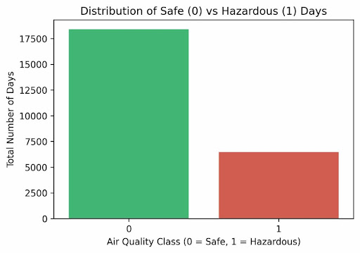
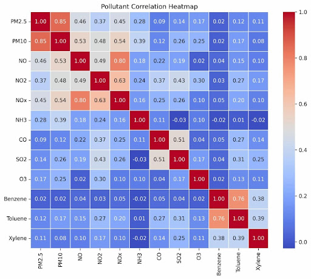
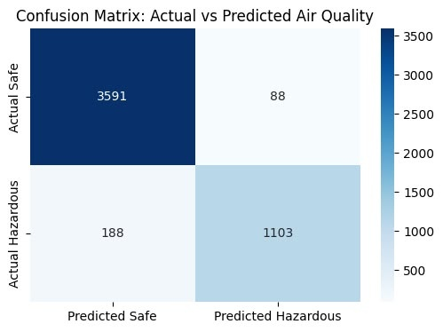
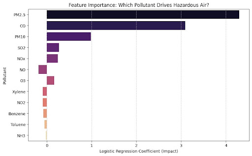
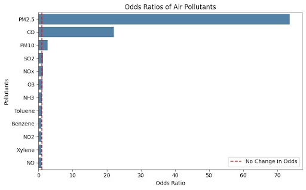
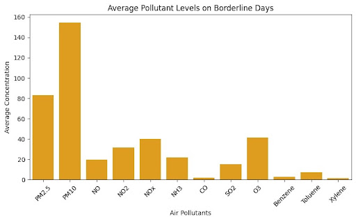
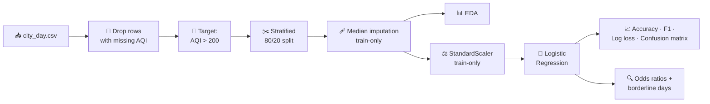

<div align="center">

# 🌫️ AQI Hazardous Prediction

**Classifying hazardous air-quality days in Indian cities from 12 pollutant concentrations using Logistic Regression.**


*AI101: Data Science and AI Essentials with Python · School of AI & Data Engineering, IIT Ropar*

</div>

---

## 📑 Contents

| Required section | Jump to |
| :--- | :--- |
| 1. Title + description | [Top of page](#-aqi-hazardous-prediction) |
| 2. Team and roles | [Team & Roles](#1-team--roles) |
| 3. Project structure | [Project Structure](#2-project-structure) |
| 4. Setup (Python version, requirements.txt) | [Setup](#3-setup) |
| 5. Steps to run | [Steps to Run](#4-steps-to-run) |
| 6. Expected output | [Expected Output](#5-expected-output) |
| 7. Links: slides and video | [Links](#6-links-slides-and-video) |
| 8. AI-use disclosure | [AI-Use Disclosure](#7-ai-use-disclosure) |
| Project details | [Problem](#8-problem-statement--motivation) · [Dataset](#9-dataset) · [Pre-processing](#10-data-pre-processing) · [EDA](#11-exploratory-data-analysis) · [Model](#12-model) · [Evaluation](#13-evaluation) · [Odds ratios](#14-odds-ratio--borderline-analysis) · [Interpretation](#15-interpretation-of-results) · [Limitations](#16-limitations--future-work) |

### ⚡ At a glance

| | |
| :--- | :--- |
| **Task** | Binary classification: hazardous (AQI > 200) vs non-hazardous (AQI ≤ 200) |
| **Data** | 24,850 daily records · 12 pollutant features · 74 : 26 class split |
| **Model** | Logistic Regression on standardised features |
| **Test results** | Accuracy **94.45%** · F1 **0.8888** · Log loss **0.1486** |
| **Key finding** | **PM2.5** (odds ratio ≈ 73.5) and **CO** (≈ 22.1) drive hazardous predictions |

---

## 1. Team & Roles

Every member wrote code and committed from their own GitHub account (see the [commit history](https://github.com/2026aib1072-dev/Air-quality-ai101-project/commits/main)).

| Member | Entry no. | GitHub | Lead role (deliverable) | Code contribution |
| :--- | :--- | :--- | :--- | :--- |
| **Vineet Shekhar** | 2026AIBxxxx | [@vin-it-1501](https://github.com/vin-it-1501) | 📄 **Documentation lead** | Data loading, cleaning, stratified train-test split |
| **Rishabh Vishnoi** | 2026AIB1072 | [@2026aib1072-dev](https://github.com/2026aib1072-dev) | ▶️ **Execution lead** (setup, `requirements.txt`, run steps) | Exploratory data analysis, initial model development |
| **Sandeep Kumar** | 2026AIBxxxx | [@Sandeepkumar2008](https://github.com/Sandeepkumar2008) | 🖼️ **PPT lead** | Odds-ratio and borderline analysis |
| **Divya Godara** | 2026AIBxxxx | [@Divyaa73](https://github.com/Divyaa73) | 🎥 **Video lead** | Model evaluation and visualisations |

---

## 2. Project Structure

```text
Air-quality-ai101-project/
│
├── README.md                                            # This file
├── requirements.txt                                     # Pinned dependencies
├── city_day.csv                                         # Dataset (included, loaded via relative path)
│
├── air_quality_master_pipeline.ipynb                    # ⭐ Final end-to-end pipeline (run this)
├── 01_data_preprocessing_vineet_updated.ipynb           # Vineet: loading, cleaning, split
├── 02_eda_and_modeling_rishabh.ipynb                    # Rishabh: EDA + initial model
├── 04_Model_evaluation_and_visualizations.ipynb         # Divya: evaluation & plots
├── 5_odds_ratios_and_borderline_analysis_sandeep.ipynb  # Sandeep: odds ratios + borderline analysis
├── merge_script.ipynb                                   # Merges the individual notebooks
│
├── <Presentation>.pdf                                   # 5-slide presentation
└── 90300.jpg … 90305.jpg                                # Result figures shown in this README
```

---

## 3. Setup

- **Python:** developed and tested on **Python 3.13** (Windows / PowerShell).
- **Dependencies:** pinned in [`requirements.txt`](requirements.txt).

| Library | Version |
| :--- | :--- |
| Pandas | 2.2.3 |
| NumPy | 2.4.6 |
| Scikit-learn | 1.6.1 |
| Matplotlib | 3.10.0 |
| Seaborn | 0.13.2 |
| Jupyter / nbconvert / ipykernel | needed to execute the notebook |

The dataset `city_day.csv` ([Kaggle – Air Quality Data in India](https://www.kaggle.com/datasets/rohanrao/air-quality-data-in-india)) is already in the repository and is read with a **relative path**, so no download step is needed. Run the notebook from the repository root.

---

## 4. Steps to Run

Run these commands **in order**.

**Step 1 – Clone the repository** *(~10 s)*
```powershell
git clone https://github.com/2026aib1072-dev/Air-quality-ai101-project.git
```

**Step 2 – Go into the project folder** *(~5 s)*
```powershell
cd Air-quality-ai101-project
```

**Step 3 – Create and activate a virtual environment** *(~15 s)*
```powershell
python -m venv venv
venv\Scripts\activate          # macOS / Linux: source venv/bin/activate
```

**Step 4 – Install the dependencies** *(~30–60 s)*
```powershell
python -m pip install -r requirements.txt
```

**Step 5 – Execute the master pipeline from top to bottom** *(~1 min)*
```powershell
python -m nbconvert --to notebook --execute air_quality_master_pipeline.ipynb
```
This runs every cell without opening Jupyter and writes the executed copy to `air_quality_master_pipeline.nbconvert.ipynb`.

> **Prefer an interactive run?** Use `jupyter notebook air_quality_master_pipeline.ipynb` → *Run → Run All Cells*, or open the notebook in **Google Colab** via the badge inside it (upload `city_day.csv` to the session first).

---

## 5. Expected Output

After a successful run you should see, in order:

```text
Original Dataset Shape: (29531, 16)
Shape after removing missing targets: (24850, 16)
Number of Features: 12
Training Set Shape: (19880, 12)
Testing Set Shape: (4970, 12)
Final Target Distribution:  0 → 18394   1 → 6456
Missing Values in Training Data: 0
Missing Values in Testing Data: 0

Training Loss (Log Loss) : 0.1611  | Testing Loss: 0.1486
Training Accuracy        : 94.36% | Testing Accuracy: 94.45%
Training F1-Score        : 0.8871  | Testing F1-Score: 0.8888
Conclusion: Low training error achieved. Model is NOT underfitting!

Found 174 borderline days on the edge of hazardous classification.
```

…followed by the figures below.

**Class balance and correlation heatmap (EDA)**

 &nbsp; 

**Confusion matrix and classification report**



**Feature importance and odds ratios**

 &nbsp; 

**Average pollutant levels on borderline days**



---

## 6. Links: Slides and Video

| Deliverable | Link |
| :--- | :--- |
| 📄 **Presentation (5 slides)** | [`<ppt_AQI_Hazardous>.pdf`](./) *(in this repository)* |
| 🎥 **Video demonstration (≤ 5:00)** | [▶ Watch on YouTube](ADD_YOUR_YOUTUBE_LINK_HERE) |

**What the video covers** (following the course's suggested 5-minute plan):

| Time | Segment | Speaker |
| :-: | :--- | :--- |
| 0:00 – 0:30 | Team introduction and roles | All |
| 0:30 – 1:30 | Problem, motivation, dataset and approach | Vineet |
| 1:30 – 3:30 | Live run from GitHub: clone → install → run; walk through pre-processing, split, scaling, training | Rishabh |
| 3:30 – 4:30 | Results: confusion matrix, precision / recall / F1, odds ratios, borderline days, interpretation | Divya, Sandeep |
| 4:30 – 5:00 | Who did what + AI-use disclosure | All |

---

## 7. AI-Use Disclosure

| Tool | Used for | How we checked it |
| :--- | :--- | :--- |
| **ChatGPT** | Explaining ML concepts, code troubleshooting, first drafts of documentation | Ran and tested every code change; reviewed all text against our own results |
| **Claude** | Restructuring and polishing this README and drafting `requirements.txt` | Compared every number in the README with the notebook outputs; commands tested on a fresh clone |

- No AI was used to generate the dataset or the results; all numbers come from running our notebooks on `city_day.csv`.
- The code, model execution, interpretation and final verification are the team's responsibility, and every member can explain any part of the project.

---

# 📘 Project Details

## 8. Problem Statement & Motivation

Air pollution is a major public-health concern in India: long exposure to high levels of **PM2.5, PM10, CO and SO₂** is linked to respiratory and cardiovascular disease. Automatically flagging dangerous days from raw pollutant readings supports early warnings and policy decisions.

**Objective:** build a model that classifies a day as *hazardous* or *non-hazardous* from pollutant concentrations, and explain *which pollutants drive the decision*.

| Class | Label | Rule (threshold chosen for this project) |
| :---: | :--- | :--- |
| `0` | Non-Hazardous (Safe/Moderate) | AQI ≤ 200 |
| `1` | Hazardous | AQI > 200 |

> On the Indian AQI scale, AQI > 200 covers the *Poor, Very Poor and Severe* categories; we group them as "hazardous" for this project.



## 9. Dataset

| Property | Details |
| :--- | :--- |
| **Name / file** | Air Quality Data in India · `city_day.csv` |
| **Source** | [Kaggle – Air Quality Data in India](https://www.kaggle.com/datasets/rohanrao/air-quality-data-in-india) |
| **Raw size** | 29,531 rows × 16 columns (daily readings per city) |
| **Used size** | 24,850 rows (rows without an AQI value removed) |
| **Features (12)** | `PM2.5, PM10, NO, NO2, NOx, NH3, CO, SO2, O3, Benzene, Toluene, Xylene` |
| **Dropped** | `City`, `Date` (metadata); `AQI`, `AQI_Bucket` (the target and its derivative → avoids leakage) |
| **Target** | `Is_Hazardous`: 0 = Non-Hazardous, 1 = Hazardous |

| Class | Count | Share |
| :--- | ---: | ---: |
| 0 – Non-Hazardous | 18,394 | 74.02% |
| 1 – Hazardous | 6,456 | 25.98% |

## 10. Data Pre-processing

| Step | What we did | Why |
| :--- | :--- | :--- |
| Remove missing targets | 29,531 → **24,850** rows | A label is needed for supervised learning |
| Create target | `Is_Hazardous = (AQI > 200)` | Converts the task to binary classification |
| Feature selection | Dropped `City`, `Date`, `AQI`, `AQI_Bucket` → **12 features** | Avoids metadata and target leakage |
| Stratified split | 80 : 20, `random_state=42`, `stratify=y` → train `(19880, 12)`, test `(4970, 12)` | Keeps the 74 : 26 ratio in both sets |
| Missing values | **Median imputation**, medians learned on the **training set only** | Robust to outliers; no leakage into the test set |
| Scaling | `StandardScaler` (mean 0, std 1), fitted on **training data only** | Logistic Regression is scale-sensitive; coefficients become comparable |

Result: **0 missing values** remain in the train and test sets. Some pollutants have many gaps in the raw data (e.g. Xylene is present in only ~9.5k of 24.8k rows), so imputation matters for those features.

## 11. Exploratory Data Analysis

 &nbsp; 

- Pollutant distributions are **right-skewed with large outliers** (PM2.5 mean ≈ 67, max ≈ 915) → motivates median imputation and scaling.
- The data is **imbalanced** (~26% hazardous) → accuracy alone is not enough, so we also report precision, recall and F1.
- Several pollutants are **correlated** (NO / NO2 / NOx), which affects coefficient interpretation (see §15).

## 12. Model

**Logistic Regression** (`sklearn.linear_model.LogisticRegression`, `max_iter=1000`, `random_state=42`), trained on the scaled training set.

- Target is binary and the model outputs a **probability** of a hazardous day.
- **Interpretable:** coefficients convert directly into odds ratios.
- A strong, fast baseline for tabular pollutant data.

## 13. Evaluation

All test numbers come from 4,970 samples the model never saw.

| Metric | Training | Testing |
| :--- | :---: | :---: |
| **Accuracy** | 94.36% | **94.45%** |
| **F1-score** | 0.8871 | **0.8888** |
| **Log loss** | 0.1611 | **0.1486** |

Train and test results are almost identical → the model is **neither underfitting nor overfitting**.

| Class | Precision | Recall | F1 | Support |
| :--- | :---: | :---: | :---: | :---: |
| Safe (0) | 0.95 | 0.98 | 0.96 | 3,679 |
| Hazardous (1) | 0.93 | 0.85 | 0.89 | 1,291 |
| **Accuracy** | | | **0.94** | 4,970 |
| Macro avg | 0.94 | 0.92 | 0.93 | 4,970 |
| Weighted avg | 0.94 | 0.94 | 0.94 | 4,970 |


The model is very reliable at confirming safe days (recall 0.98), and when it predicts "hazardous" it is right 93% of the time. Its weaker side is **hazardous recall (0.85)**: about 15% of truly hazardous days are missed.

## 14. Odds Ratio & Borderline Analysis

Features are standardised, so each odds ratio is the **multiplicative change in the odds of a hazardous day for a +1 standard-deviation increase in that pollutant**, holding the others constant.

 &nbsp; 

| Pollutant | Coefficient | Odds ratio | Effect |
| :--- | ---: | ---: | :--- |
| **PM2.5** | 4.2977 | **73.53** | 🔴 Dominant driver |
| **CO** | 3.0943 | **22.07** | 🔴 Very strong |
| PM10 | 0.9830 | 2.67 | 🟠 Strong |
| SO2 | 0.2736 | 1.31 | 🟡 Moderate |
| NOx | 0.2489 | 1.28 | 🟡 Moderate |
| O3 | 0.1674 | 1.18 | 🟡 Weak |
| NH3 | −0.0190 | 0.98 | ⚪ ≈ none |
| Toluene | −0.0492 | 0.95 | ⚪ slightly < 1 |
| Benzene | −0.0808 | 0.92 | ⚪ slightly < 1 |
| NO2 | −0.0873 | 0.92 | ⚪ slightly < 1 |
| Xylene | −0.0914 | 0.91 | ⚪ slightly < 1 |
| NO | −0.1891 | 0.83 | ⚪ slightly < 1 |

**Borderline (tipping-point) days** are test days where the predicted hazard probability lies between **40% and 60%**; the model is least certain there. We found **174** such days, with these average raw concentrations:

| PM2.5 | PM10 | NO | NO2 | NOx | NH3 | CO | SO2 | O3 | Benzene | Toluene | Xylene |
| :---: | :---: | :---: | :---: | :---: | :---: | :---: | :---: | :---: | :---: | :---: | :---: |
| 83.30 | 154.69 | 19.89 | 31.51 | 39.98 | 22.00 | 2.09 | 15.46 | 41.43 | 2.83 | 7.39 | 1.66 |


## 15. Interpretation of Results

1. **Particulate matter decides hazardous days.** PM2.5 (odds ×73.5) and PM10 (×2.7) dominate, consistent with how AQI is computed and with known pollution patterns in India.
2. **Carbon monoxide is the second-strongest signal** (×22.1), typical of combustion-heavy pollution episodes.
3. **Odds ratios below 1 do not mean a pollutant "cleans" the air.** NO, NO2 and NOx are strongly correlated; once NOx is in the model, NO and NO2 receive small negative coefficients to compensate (a multicollinearity effect).
4. **Where the model hesitates:** on borderline days PM2.5 averages ≈ 83 µg/m³ and PM10 ≈ 155 µg/m³: elevated but not extreme. The decision boundary is driven mainly by particulate levels.
5. **Practical meaning:** at ~94% accuracy this is a good screening tool, but because hazardous recall is 0.85, borderline predictions should be treated as *"possible risk"*, not *"safe"*.

## 16. Limitations & Future Work

**Limitations**
- **The label is derived from the inputs:** AQI is computed from pollutant concentrations (mainly PM2.5, PM10, CO), so high accuracy is partly expected: the model approximates the AQI formula.
- AQI > 200 merges several official categories into one "hazardous" class.
- Heavy imputation for some pollutants (Xylene, PM10, NH3).
- Linear model only; no cross-validation, hyper-parameter tuning or threshold optimisation (default 0.5 used).
- `City` and `Date` are dropped and the split is random rather than time-based.

**Future work**
- Compare Random Forest / Gradient Boosting and add k-fold cross-validation.
- Tune the decision threshold to raise hazardous recall; add ROC-AUC and Precision-Recall curves.
- Forecast *tomorrow's* hazard from past days instead of classifying the same day.
- Try class weighting or SMOTE for the 74 : 26 imbalance.

---

## ✅ Conclusion

A simple, interpretable Logistic Regression model classifies hazardous air-quality days with **94.45% test accuracy** and an **F1-score of 0.889**, with almost identical train and test performance. Leakage-free imputation and scaling, stratified splitting and class-aware metrics keep the evaluation trustworthy. Odds ratios identify **PM2.5 and CO** as the dominant drivers, and the borderline analysis shows the pollutant levels at which the model becomes uncertain.

---

<div align="center">

**Course:** AI101 · **Project:** AQI Hazardous Prediction – Air Quality Prediction and Hazardous Day Classification
**Repository:** [2026aib1072-dev/Air-quality-ai101-project](https://github.com/2026aib1072-dev/Air-quality-ai101-project)

</div>
