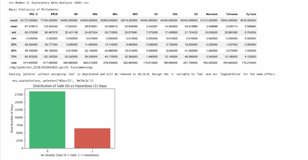
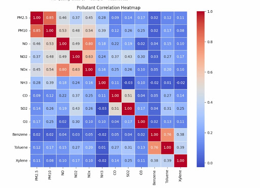
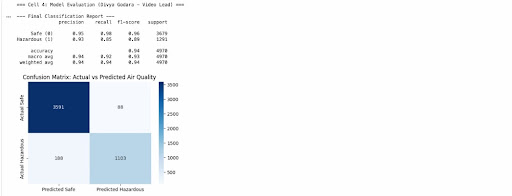
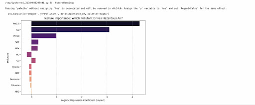
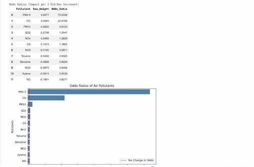

# AQI Hazardous Prediction

**Air Quality Prediction & Hazardous Day Classification Using Machine Learning**

## 1. Project Overview

This project focuses on predicting hazardous air quality conditions using Machine Learning techniques.

It uses historical air quality data from Indian cities and develops a binary classification model to identify whether a day is hazardous or non-hazardous based on pollutant concentrations.

The project includes data preprocessing, exploratory data analysis, Logistic Regression, model evaluation, odds ratio analysis, and borderline prediction analysis.

## 2. Problem Statement and Motivation

Air pollution is a major environmental concern in India. Exposure to high concentrations of pollutants such as PM2.5, PM10, CO, and SO2 can negatively affect human health.

The objective of this project is to develop a Machine Learning model that classifies air quality conditions as hazardous or non-hazardous using pollutant concentration data.

For this project, the following AQI threshold is used:

* **Non-Hazardous (0):** AQI ≤ 200
* **Hazardous (1):** AQI > 200

This threshold is selected for the purpose of this project.

## 3. Dataset Description

* **Dataset Name:** Air Quality Data in India
* **Dataset File:** `city_day.csv`
* **Source:** Kaggle – Air Quality Data in India

The dataset contains historical air quality measurements from different Indian cities.

**Features Used**
The model uses 12 pollutant-related features:
PM2.5, PM10, NO, NO2, NOx, NH3, CO, SO2, O3, Benzene, Toluene, Xylene.

**Target Variable**
`Is_Hazardous`
* 0 – Non-Hazardous
* 1 – Hazardous

## 4. Technologies and Libraries Used

The project uses the following technologies:
Python, Jupyter Notebook, Pandas, NumPy, Scikit-learn, Matplotlib, Seaborn, Git, and GitHub.

## 5. Software and Library Versions

The following software and library versions were used during project development:

| Software / Library | Version |
| :--- | :--- |
| Python | 3.13.18 |
| Pandas | 2.2.3 |
| NumPy | 2.4.6 |
| Scikit-learn | 1.6.1 |
| Matplotlib | 3.10.0 |
| Seaborn | 0.13.2 |

## 6. Project Workflow

The project follows these major steps:

1. Dataset loading
2. Data cleaning and handling missing values
3. Creation of the binary target variable
4. Exploratory Data Analysis
5. Stratified train-test splitting
6. Feature scaling
7. Logistic Regression model development
8. Model evaluation and visualization
9. Odds ratio analysis
10. Borderline prediction analysis

## 7. Data Preprocessing

Data preprocessing prepares the dataset for Machine Learning. The major preprocessing operations include:

* **Original Dataset Shape:** (29,531, 16)
* **Shape after removing missing targets:** (24,850, 16)
* **Missing Values in Processed Data:** 0
* **Final Target Distribution (`Is_Hazardous`):** 18,394 (0 - Non-Hazardous) | 6,456 (1 - Hazardous)
* **Training Set Shape:** (19,880, 12)
* **Testing Set Shape:** (4,970, 12)

The dataset was split using an 80:20 ratio with stratified sampling to preserve the class distribution (~74.02% Non-Hazardous, ~25.98% Hazardous). Standardized features using `StandardScaler` (Data Scaled to Mean=0, Std=1). The scaler and median imputation values were learned solely from the training data and then applied to the test data to avoid data leakage.

## 8. Exploratory Data Analysis and Model Development

Exploratory Data Analysis (EDA) is performed to understand the dataset and identify patterns in air pollution.

**Basic Statistics and Class Distribution:**<br>


**Pollutant Correlation Heatmap:**<br>


**Machine Learning Algorithm**
Logistic Regression is used as the primary classification algorithm because the target variable has two classes. The model estimates the probability of a day being hazardous based on the pollutant features.

## 9. Model Evaluation and Visualizations

The trained model is evaluated using the testing dataset.
The evaluation includes classification metrics such as Accuracy, Precision, Recall, F1-score, and Log Loss.

**Confusion Matrix and Final Classification Report:**<br>


## 10. Odds Ratio and Borderline Analysis

**Odds Ratio Analysis**
Odds ratios are used to interpret the influence of pollutant features on the odds of hazardous classification. Since the features are standardized, these values represent the change in odds associated with a one-standard-deviation increase in the corresponding feature, holding other features constant.

**Feature Importance:**<br>


**Odds Ratios of Air Pollutants:**<br>


**Borderline Analysis**
Borderline analysis examines predictions that lie close to the model's classification boundary. It helps understand cases where the model has less certainty while distinguishing between hazardous and non-hazardous conditions.

## 11. Model and Evaluation Results

The final model fit and underfitting diagnostics yielded the following results:

| Evaluation Metric | Training | Testing |
| :--- | :--- | :--- |
| **Accuracy** | 94.36% | 94.45% |
| **F1-score** | 0.8871 | 0.8888 |
| **Log Loss** | 0.1611 | 0.1486 |

**Model Fit Conclusion:** Low training error achieved. Model is NOT underfitting! The recorded results indicate similar training and testing performance, suggesting that the model generalizes reasonably well to the held-out test data.

## 12. Repository Structure

The repository is organized into individual contribution notebooks, a merge script, and the final master pipeline.

```text
Air-quality-ai101-project/
│
├── README.md
├── requirements.txt
├── city_day.csv
│
├── 01_data_preprocessing_vineet_updated.ipynb
├── 02_eda_and_modeling_rishabh.ipynb
├── 04_Model_evaluation_and_visualizations.ipynb
├── 5_odds_ratios_and_borderline_analysis_sandeep.ipynb
│
├── merge_script.ipynb
└── air_quality_master_pipeline.ipynb

## 9. Model Evaluation and Visualizations

The trained model is evaluated using the testing dataset.
The evaluation includes the following classification metrics: Accuracy, Precision, Recall, F1-score, Log Loss, and a Confusion Matrix. 


## 10. Odds Ratio and Borderline Analysis

**Feature Importance & Odds Ratio Analysis**
Odds ratios are used to interpret the influence of pollutant features on the odds of hazardous classification. 


Since the features are standardized, these values represent the change in odds associated with a one-standard-deviation increase in the corresponding feature, holding other features constant.


Some key recorded odds ratios include:
| Feature | Odds Ratio |
| :--- | :--- |
| PM2.5 | 73.5339 |
| CO | 22.0709 |
| PM10 | 2.6723 |
| SO2 | 1.3147 |
| NOx | 1.2826 |

**Borderline Analysis**
Borderline analysis examines predictions that lie close to the model's classification boundary. It helps understand cases where the model has less certainty while distinguishing between hazardous and non-hazardous conditions.

## 11. Model and Evaluation Results

The model fit and underfitting diagnostics yielded the following final results:

| Evaluation Metric | Training | Testing |
| :--- | :--- | :--- |
| **Accuracy** | 94.36% | 94.45% |
| **F1-score** | 0.8871 | 0.8888 |
| **Log Loss** | 0.1611 | 0.1486 |

**Model Fit Conclusion:** Low training error achieved. The model is NOT underfitting! The recorded results indicate nearly identical training and testing performance, suggesting that the model generalizes exceptionally well to the held-out test data.

## 12. Repository Structure

The repository is organized into individual contribution notebooks, a merge script, and the final master pipeline.

```text
Air-quality-ai101-project/
│
├── README.md
├── requirements.txt
├── city_day.csv
│
├── 01_data_preprocessing_vineet_updated.ipynb
├── 02_eda_and_modeling_rishabh.ipynb
├── 04_Model_evaluation_and_visualizations.ipynb
├── 5_odds_ratios_and_borderline_analysis_sandeep.ipynb
│
├── merge_script.ipynb
└── air_quality_master_pipeline.ipynb
```

## 13. Installation and Execution

Follow the steps below to clone the repository, install the required dependencies, and execute the master pipeline.

**Step 1: Clone the repository** (Estimated time: 10 seconds)
```powershell
git clone https://github.com/2026aib1072-dev/Air-quality-ai101-project.git
```

**Step 2: Navigate to the project directory** (Estimated time: 5 seconds)
```powershell
cd Air-quality-ai101-project
```

**Step 3: Pull the latest changes from the main branch** (Estimated time: 10 seconds)
```powershell
git pull origin main
```

**Step 4: Install all required libraries** (Estimated time: 30 seconds)
```powershell
python -m pip install -r requirements.txt
```

**Step 5: Execute the master pipeline headlessly** (Estimated time: 1 minute)
```powershell
python -m nbconvert --to notebook --execute air_quality_master_pipeline.ipynb
```
*This command executes the master notebook from top to bottom without requiring manual interaction with the Jupyter Notebook interface. Note: Actual execution time may vary depending on system specifications and internet speed. Python 3.13 is recommended for the listed library versions.*

## 14. Team Members and Contributions

| Team Member | GitHub Username | Contribution |
| :--- | :--- | :--- |
| Vineet Shekhar | vin-it-1501 | Data Loading, Cleaning, Stratified Train-Test Split and Documentation |
| Rishabh Vishnoi | 2026aib1072-dev | Exploratory Data Analysis and Initial Model Development |
| Divya Godara | Divyaa73 | Model Evaluation and Visualizations |
| Sandeep Kumar | Sandeepkumar2008 | Odds Ratio and Borderline Analysis |

## 15. Project Presentation and Video Demonstration

**Project Presentation**
The project presentation is included in the GitHub repository as a PDF.

**Video Demonstration**
The video demonstration explains the project workflow, team contributions, data preprocessing, model development, execution, and evaluation results.
*Video Link: [Add the YouTube video link here after uploading the final demonstration]*

## 16. AI Disclosure

Generative AI tools, including ChatGPT, were used as supporting tools during project development for assistance with documentation drafting, explanation of Machine Learning concepts, code troubleshooting, and improving the presentation of project information.

AI-generated suggestions were reviewed and adapted by the team. The project code, dataset processing, model execution, interpretation of results, and final verification remain the responsibility of the project team.

## 17. Conclusion

This project demonstrates how Machine Learning can be applied to classify hazardous air quality conditions using pollutant concentration data. 

By combining data preprocessing, exploratory data analysis, Logistic Regression, model evaluation, odds ratio interpretation, and borderline analysis, the project provides an approach to studying the relationship between air pollutants and hazardous air quality. The project also highlights the importance of proper data handling, feature scaling, stratified sampling, and model interpretation in building a classification pipeline.

---
* **Course:** AI101
* **Project Title:** AQI Hazardous Prediction – Air Quality Prediction and Hazardous Day Classification
* **GitHub Repository:** https://github.com/2026aib1072-dev/Air-quality-ai101-project
